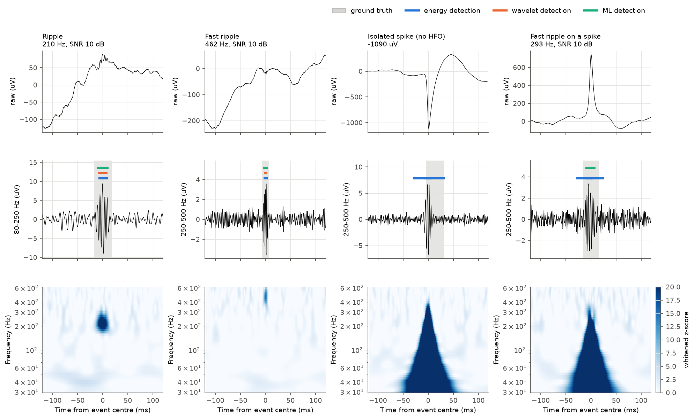
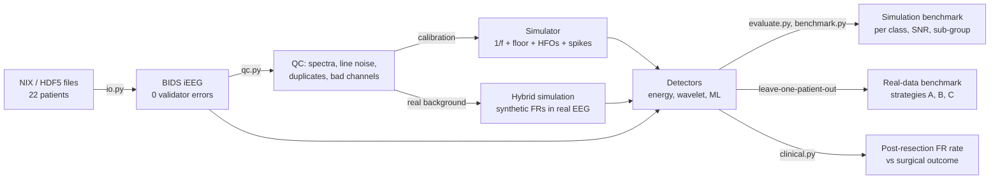
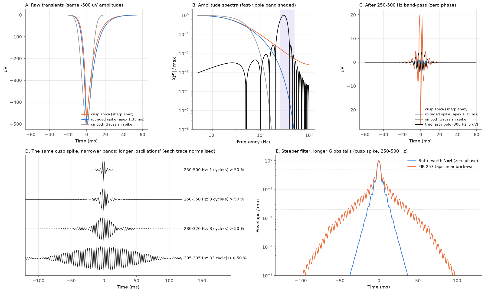
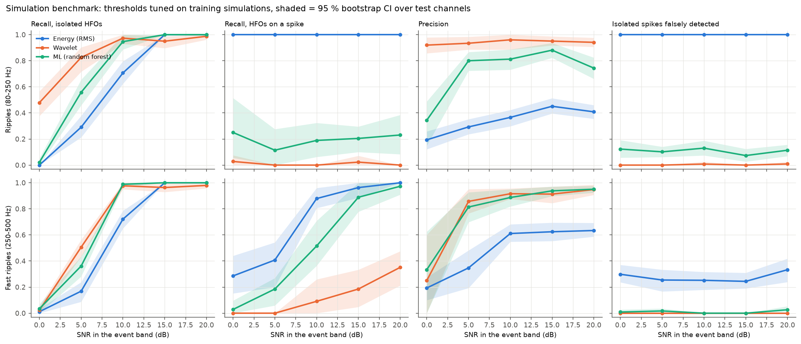
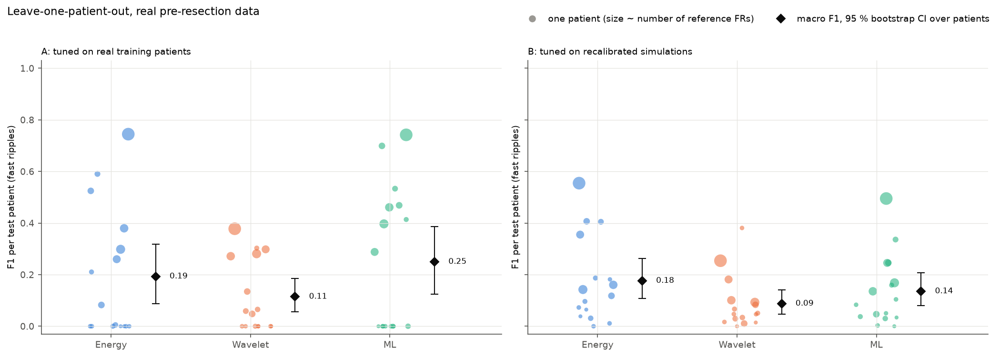
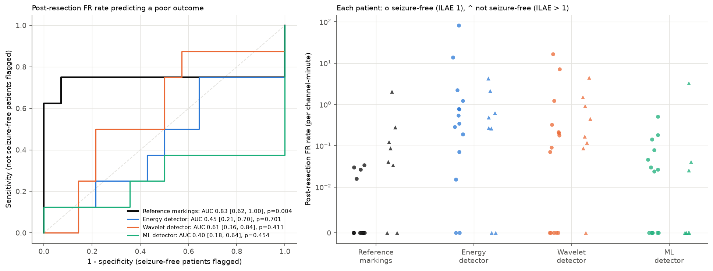

# EpiDetect

**A reproducible benchmark of high-frequency oscillation (HFO) detectors**: a calibrated simulator
with exact ground truth, three detectors (energy, wavelet, machine learning) evaluated per class,
per SNR and per patient, and a clinical analysis on public intraoperative ECoG.



## Contents
- [Why this project](#why-this-project)
- [Pipeline](#pipeline)
- [Data](#data)
- [Installation and reproduction](#installation-and-reproduction)
- [Key figures](#key-figures)
- [Results](#results)
- [Main findings](#main-findings)
- [Limitations](#limitations)
- [Future work](#future-work)
- [Project structure](#project-structure)
- [Documentation](#documentation)
- [What I learned](#what-i-learned)
- [License and references](#license-and-references)

## Why this project

Fast ripples (250–500 Hz) in intracranial EEG are candidate biomarkers of epileptogenic tissue,
and many automatic detectors exist. Comparing them is hard: real "ground truth" is a
detector-made, incomplete reference, and a band-pass filter turns sharp epileptic spikes into
false oscillations. Following the benchmark idea of **Roehri et al. (PLOS ONE, 2017)** and the
time–frequency approach of **Roehri et al. (IEEE TBME, 2016)**, this project:

1. builds a **simulator** with exact ground truth, calibrated on the real data;
2. implements **three detectors**:
   - an RMS-energy detector, in the spirit of Staba et al. (2002);
   - a whitened Morlet time–frequency detector, which rejects spikes with a "blob or column"
     test. The principle comes from Delphos; the code is independent and no code was copied;
   - a random-forest classifier on candidate features;
3. evaluates them **per class, per SNR and per event sub-group** on simulations, then
   **leave-one-patient-out** on real fast-ripple markings, with bootstrap confidence intervals;
4. tests whether **post-resection fast ripples predict the surgical outcome**.

## Pipeline



**Tech stack:** Python 3.11, NumPy, SciPy, pandas, MNE-Python, MNE-BIDS, scikit-learn,
Matplotlib, h5py, pytest, ruff, GitHub Actions.

## Data

Intraoperative ECoG before and after resection from 22 patients (University Hospital Zurich),
with fast-ripple markings and surgical outcome (Boran et al., Clin Neurophysiol 2019). The data
are **not** stored in this repository. Download the 22 `Data_Patient_XX.h5` files from
<https://gin.g-node.org/USZ_NCH/Intraoperative_ECoG_HFO> (folder `data/`) into `data/raw/`.

Details, quirks and anomalies found during the quality control are in
[docs/DATA_NOTES.md](docs/DATA_NOTES.md). The raw files store a 1-based channel index, three
recordings are duplicated, and one channel was effectively sampled at 1000 Hz.

## Installation and reproduction

**Windows (PowerShell)**
```powershell
git clone <this repository> ; cd epidetect
.\run.ps1 setup       # .venv + pinned dependencies (requirements.txt) + package
.\run.ps1 run         # scripts/00 ... 14 in order (long without cache, see the table)
.\run.ps1 notebooks   # re-execute notebooks/01 ... 05
.\run.ps1 test        # 87 unit tests (no real data needed)
.\run.ps1 lint        # ruff check + format check
.\run.ps1 pdf         # build the PDF documents in docs/
```

**Linux / macOS**
```bash
python3.11 -m venv .venv && source .venv/bin/activate
pip install -r requirements.txt && pip install -e .
for s in scripts/[0-9][0-9]_*.py; do python "$s" || break; done
python scripts/run_notebooks.py && pytest
```

| Script | What it produces |
|---|---|
| `00_inventory_raw.py` | `docs/data_inventory.md`, a read-only inventory of the raw NIX files |
| `01_convert_to_bids.py` | `data/bids/` (git-ignored), `results/bids_conversion.csv` |
| `02_quality_control.py` | `results/qc_*.csv`, `figures/qc_*.png`, bad channels marked in BIDS |
| `03_calibrate_simulator.py` | background spectrum and spike sharpness fitted on real data: `results/background_fit*.csv`, `results/spike_*.csv` |
| `04_simulation_examples.py` | `figures/sim_examples.png`, `figures/sim_snr_levels.png` |
| `05_spike_filter_demo.py` | why a filtered spike looks like an HFO: `figures/false_hfo_demo.png` |
| `06_notch_decision.py` | effect of notch filtering on real detections: `results/notch_decision.csv` |
| `07_detector_examples.py` | `figures/detector_examples.png` |
| `08_evaluate_simulations.py` | simulation benchmark: `results/sim_eval_*.csv`, `figures/sim_benchmark_snr.png` |
| `09_ml_frequency_check.py` | does the ML detector rely on a simulator artefact? `results/ml_frequency_check.csv` |
| `10_evaluate_real.py` | leave-one-patient-out, strategies A and B: `results/real_lopo_*.csv`, `figures/real_lopo.png` |
| `11_real_fr_context.py` | share of real FRs riding on a spike: `results/real_fr_context.csv` |
| `12_evaluate_hybrid.py` | strategy C (hybrid simulation) and A/B/C comparison: `results/strategy_*.csv` |
| `13_clinical.py` | clinical analysis: `results/clinical_*.csv`, `figures/clinical_roc.png` |
| `14_results_summary.py` | the results tables of this README (`results/summary_tables.md`) |

- **Cache.** Intermediate analyses are cached in `data/derived/` (git-ignored). The cache folder
  name contains a hash of the configuration, so a parameter change never reuses stale results.
  Re-running everything gives byte-identical tables and figures.
- **Parameters.** All of them are in [configs/default.toml](configs/default.toml).
- **BIDS validation.** The output passes the official validator
  (`npx bids-validator@1.15.0 data/bids`: 0 errors, 0 warnings, 488 files).
- **Optional channel-level clinical analysis.** If you have channel-level resection labels,
  save them as `data/resection_labels.csv` with columns `patient,channel,resected` (patient as
  two digits, e.g. `01`; channel as in BIDS, e.g. `01-02`; `resected` as `True`/`False`). The
  script `13_clinical.py` then computes, for each patient, the AUC of pre-resection channel FR
  rates against the resection labels. No such labels exist for the public dataset.

## Key figures

**1. Why a filtered spike looks like an HFO.** A sharp spike, once band-passed, rings like a fast
ripple. Narrower bands and steeper filters ring longer.


**2. Simulation benchmark.** Recall, precision and spike false alarms versus SNR, per class.
Shaded areas are 95 % bootstrap CIs.


**3. Real data, leave-one-patient-out.** F1 per test patient and macro F1 with 95 % CI. A: tuned
on real training patients; B: tuned on the synthetic simulator.


**4. Clinical analysis.** ROC of the post-resection FR rate for predicting a poor outcome.


More figures in [figures/](figures/): QC spectra, simulator calibration, hybrid-simulation
comparison, frequency check.

## Results

All numbers below are written by `scripts/14_results_summary.py` from the result files.

<!-- RESULTS:START -->
**Simulations, SNR 10 dB** (`results/sim_eval_metrics.csv`; 95 % bootstrap CI over 10 test channels of 120 s)

| Band | Detector | F1 | Precision | Recall, isolated HFOs | Recall, HFOs on a spike | Isolated spikes detected |
|---|---|---|---|---|---|---|
| Fast ripples | Energy (RMS) | 0.68 [0.64, 0.72] | 0.61 | 0.72 | 0.88 | 25 % |
| Fast ripples | Wavelet (Morlet) | 0.81 [0.76, 0.86] | 0.92 | 0.98 | 0.09 | 0 % |
| Fast ripples | ML (random forest) | 0.87 [0.82, 0.92] | 0.89 | 0.99 | 0.52 | 0 % |
| Ripples | Energy (RMS) | 0.50 [0.44, 0.56] | 0.37 | 0.71 | 1.00 | 100 % |
| Ripples | Wavelet (Morlet) | 0.78 [0.71, 0.81] | 0.96 | 0.97 | 0.00 | 1 % |
| Ripples | ML (random forest) | 0.75 [0.70, 0.80] | 0.81 | 0.95 | 0.19 | 13 % |

**Real data, fast ripples, leave-one-patient-out** (`results/strategy_comparison.csv`; 16 patients with reference FRs, 95 % bootstrap CI over patients)

| Strategy | Detector | Macro F1 | Micro F1 | FP / min (3 patients without FR) | Median threshold |
|---|---|---|---|---|---|
| A: tuned on real training patients | Energy (RMS) | 0.19 [0.09, 0.32] | 0.52 | 0.30 | k = 8 |
| A: tuned on real training patients | Wavelet (Morlet) | 0.11 [0.06, 0.19] | 0.30 | 0.06 | z = 12 |
| A: tuned on real training patients | ML (random forest) | 0.25 [0.12, 0.39] | 0.61 | 0.00 | p = 0.4 |
| B: tuned on synthetic simulator | Energy (RMS) | 0.18 [0.11, 0.26] | 0.27 | 0.69 | k = 3.5 |
| B: tuned on synthetic simulator | Wavelet (Morlet) | 0.09 [0.05, 0.14] | 0.11 | 1.52 | z = 6 |
| B: tuned on synthetic simulator | ML (random forest) | 0.14 [0.08, 0.21] | 0.22 | 1.55 | p = 0.4 |
| C: tuned on hybrid simulation | Energy (RMS) | 0.20 [0.09, 0.32] | 0.49 | 0.33 | k = 7 |
| C: tuned on hybrid simulation | Wavelet (Morlet) | 0.12 [0.06, 0.19] | 0.30 | 0.06 | z = 12 |
| C: tuned on hybrid simulation | ML (random forest) | 0.11 [0.03, 0.21] | 0.10 | 0.00 | p = 0.55 |

**Clinical, patient level** (`results/clinical_auc.csv`; post-resection FR rate vs not seizure-free; 8 vs 14 patients; stratified bootstrap CI)

| Score | AUC [95 % CI] | Permutation p |
|---|---|---|
| Reference markings | 0.83 [0.62, 1.00] | 0.004 |
| Energy (RMS) detector | 0.45 [0.21, 0.70] | 0.701 |
| Wavelet (Morlet) detector | 0.61 [0.36, 0.84] | 0.411 |
| ML (random forest) detector | 0.40 [0.18, 0.64] | 0.455 |

Rule "at least one reference FR after resection": sensitivity 6/8, specificity 10/14 (`results/clinical_rule.csv`).
<!-- RESULTS:END -->

## Main findings

1. **The false-HFO trap is real, and its size depends on spike sharpness.** A perfectly
   angular spike rings about 20 times more than real transients. Calibrating the apex sharpness
   on 8,630 real transients was necessary to avoid exaggerating it
   (`results/spike_calibration_summary.csv`).
2. **On simulations, each detector has a clear profile.**
   - The ML detector has the best fast-ripple F1 from 10 dB.
   - The wavelet detector is the most precise and rejects spikes, but misses HFOs riding on
     spikes.
   - The energy detector fires on every isolated spike in the ripple band.
3. **On real data, agreement with the reference is low and very uneven between patients.**
   - Macro F1 is 2 to 3 times lower than pooled F1, which is dominated by one patient.
   - Every detector fails on the 7 patients with 1–13 reference FRs.
   - 62 % of real FRs ride on a large transient, which explains the poor real-data recall of
     the spike-rejecting wavelet detector.
4. **Simulation-to-reality transfer.**
   - Thresholds tuned on the fully synthetic simulator are far too permissive.
   - A **hybrid simulation** (synthetic FRs in real background of the training patients)
     brings the thresholds of the energy and wavelet detectors to their real-data values.
   - It does not help the ML detector, which needs realistic positive examples.
5. **Clinical.** The reference markings reproduce the original finding: post-resection FRs
   predict a poor outcome. Our detectors do not, because their false positives drown the signal.

## Limitations

**Data**
- Only **fast ripples** are marked, by an automatic detector followed by visual validation. The
  reference is detector-biased and incomplete, and ripples can only be evaluated on
  simulations.
- No channel-level resection labels exist, so the clinical analysis is done at the patient
  level.
- The pre-resection recordings of patients 12, 15 and 17 are byte-identical in the source files
  and are excluded.
- **P22 pre-resection, channel 3-4** has duplicated samples: it was effectively sampled at
  1000 Hz, so its Nyquist frequency is 500 Hz. It is flagged and excluded from fast-ripple
  analyses.
- Small cohort: 22 patients, 8 not seizure-free, 16 with pre-resection fast ripples.
- One patient dominates. Patient 06 holds 1,413 of the 2,378 pre-resection FRs; without them,
  the calibrated FR rate drops from 2.5 to 1.1 per channel-minute and the share on spikes from
  62 % to 39 % (`results/hybrid_fold_calibration.csv`).
- The recordings are intraoperative ECoG under anaesthesia, so results may not transfer to
  chronic SEEG.

**Simulator**
- **Calibration.** The background spectrum (1/f^β with a knee, plus a white amplifier floor)
  and the spike-apex sharpness are calibrated on real data. The spike shape itself is a
  modelling choice, and the anti-aliasing roll-off above 500 Hz and the mains interference are
  not simulated.
- **Spike ringing frequency.** Simulated spikes ring at a median of 268 Hz, against 341 Hz for
  real transients and 303 Hz for real fast ripples (`results/frequency_distributions.csv`). The
  ML detector does not depend on this artefact: removing the frequency feature, or training on
  realistic frequencies, gives the same F1 (`results/ml_frequency_check.csv`).
- **Share of HFOs on spikes.** The simulator puts 30 % of HFOs on a spike. In the real data,
  62 % of the reference FRs lie within 50 ms of a large transient (`results/real_fr_context.csv`).
- **SNR definition.** The SNR is defined against the background power of the whole band. With
  a 1/f^3.5 background, a 200 Hz ripple "at 0 dB" is locally strong. SNRs are therefore not
  comparable between bands, and they favour detectors that work locally in frequency.
- **Recall on HFOs riding on spikes.** A detection may be triggered by the spike rather than by
  the oscillation (the energy detector "finds" 100 % of them in the ripple band, even at 0 dB).
  This recall must be read together with the false-alarm rate on isolated spikes.
- **Spatial structure.** There is one channel per simulation, so no spatial correlation.

**Evaluation**
- **Transfer of simulation thresholds.** Thresholds tuned on the synthetic simulator do not
  transfer to real data. With the hybrid simulation they do, but the hybrid-trained ML detector
  fails (macro recall 0.09). A plausible but untested explanation: the inserted Hann-windowed
  sinusoids are cleaner than real FRs (domain shift), and unmarked real FRs in the background are
  learned as negatives (label noise).
- **Calibration leakage.** The simulator calibration used all patients. Recalibrating without
  the test patient changes its parameters by about 1–8 % (`results/real_fold_calibration.csv`).
  Strategies B and C recalibrate in every fold anyway.
- **Bootstrap intervals.** They are percentile intervals over few units (16 patients for
  detection, 8 + 14 for the clinical AUC). They are approximate and tend to be too narrow.
- **Mains harmonics.** No notch filter is applied: on the 72 affected real channels, harmonics
  add only about 1–3 % of detections (`results/notch_decision.csv`).

**Clinical**
- The analysis is exploratory and observational. The upper bound of the AUC interval reaches
  1, and it is not known whether the markings were made blind to the outcome.
- Our detectors, which agree with the reference at macro F1 ≈ 0.2, are not clinically usable
  as they are.

## Future work

- **Simulation-based inference** (`sbi`, neural posterior estimation): use the simulator as a
  forward model to infer, from summary statistics of a recording, the posterior distribution of
  its HFO rate and SNR, instead of a thresholded count (optional step 7).
- **More realistic hybrid positives**: insert real FR waveforms extracted from the training
  patients rather than Hann-windowed sinusoids, then re-test the hybrid-trained ML detector.
- **Channel-level clinical analysis** with resection or seizure-onset-zone labels, already
  implemented (`clinical.channel_level_auc`).
- **SEEG data** and a comparison with the original Delphos detector.

## Project structure

```
epidetect/
├── README.md, LICENSE, pyproject.toml, requirements.txt, run.ps1
├── configs/default.toml          # every parameter
├── src/epidetect/
│   ├── io.py                     # NIX reading, BIDS conversion
│   ├── qc.py                     # spectra, line noise, robust flags, repeated samples
│   ├── filters.py                # zero-phase band-pass, envelope, RMS, notch
│   ├── simulate.py               # simulator with ground truth
│   ├── hybrid.py                 # synthetic FRs in real background
│   ├── detectors/{base,energy,wavelet,ml}.py
│   ├── features.py               # 11 candidate features
│   ├── evaluate.py               # matching, metrics, bootstrap
│   ├── benchmark.py              # leakage-free tuning, cached analyses
│   ├── realdata.py               # real-data loading, transients
│   └── clinical.py               # AUC, stratified bootstrap, permutation, channel level
├── scripts/                      # 00-14: every table and figure
├── notebooks/                    # 01-05: one executed notebook per step
├── tests/                        # 87 pytest tests (no real data needed)
├── results/                      # small result tables (CSV)
├── figures/                      # all figures (PNG)
└── docs/                         # data notes, walkthrough, PDFs
```

## Documentation

- [docs/DATA_NOTES.md](docs/DATA_NOTES.md): the dataset, its format and its anomalies.
- [docs/PROJECT_WALKTHROUGH.md](docs/PROJECT_WALKTHROUGH.md): step-by-step account of the project.

## What I learned

- **Evaluation is the hard part.** I had to ask what the reference really is, which unit is
  independent (the patient), how to tune without leakage (nested, grouped), and when micro
  averages lie.
- **Check every assumption against data.** A perfect cusp spike model, a valley test down to
  40 Hz and frequency estimation on a whitened map were all wrong at first, and quantitative
  checks changed the conclusions.
- **Simulations are only as useful as their calibration.** Realistic noise is enough to set
  thresholds; realistic positives are needed to train a classifier.
- **Look at the data before trusting it.** Duplicated recordings, a channel sampled at half the
  declared rate and a 1-based index were all found by looking at outputs that seemed wrong.

## License and references

The **code** is released under the [MIT License](LICENSE) (Copyright (c) 2026 Chiheb Ayari). The
license covers the code only. The **data** keep their own license, **CC BY-SA 4.0**, set by their
authors; any derived data (e.g. the BIDS conversion) must be shared under the same license with
attribution.

- Roehri N. et al., "What are the assets and weaknesses of HFO detectors? A benchmark framework
  based on realistic simulations", *PLOS ONE*, 2017.
- Roehri N. et al., "Time-Frequency Strategies for Increasing High-Frequency Oscillation
  Detectability in Intracerebral EEG", *IEEE Transactions on Biomedical Engineering*, 2016.
- Fedele T. et al., dataset "Intraoperative ECoG pre- and post-resection and fast ripple (FR)
  markings", <https://gin.g-node.org/USZ_NCH/Intraoperative_ECoG_HFO>.
- Boran E. et al., "High-density ECoG improves the detection of high frequency oscillations that
  predict seizure outcome", *Clinical Neurophysiology*, 2019.
- Staba R. J. et al., "Quantitative analysis of high-frequency oscillations (80–500 Hz) recorded
  in human epileptic hippocampus and entorhinal cortex", *Journal of Neurophysiology*, 2002.
- Bénar C. G. et al., "Pitfalls of high-pass filtering for detecting epileptic oscillations: a
  technical note on 'false' ripples", *Clinical Neurophysiology*, 2010.
